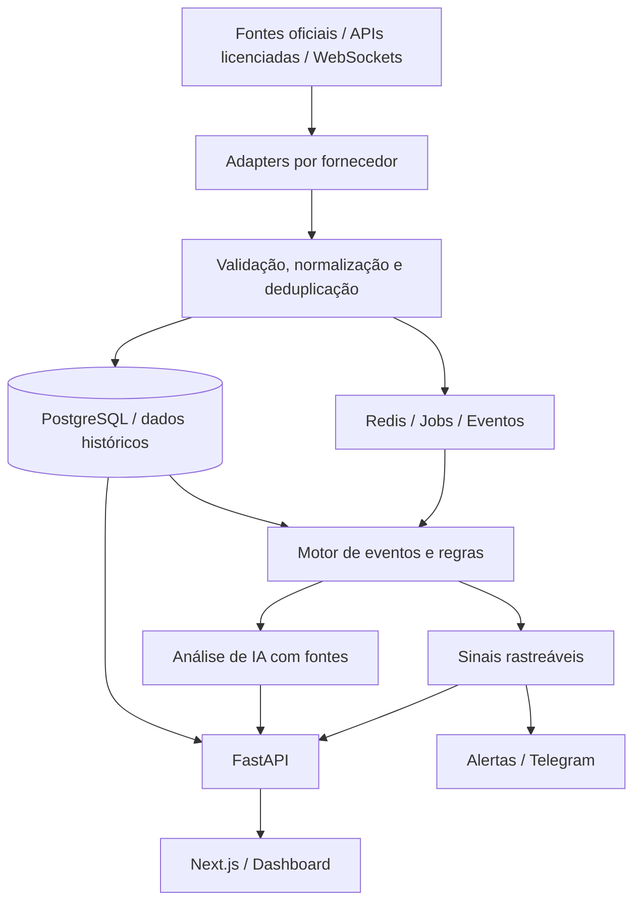

# CAPITAL INTELLIGENCE
## Briefing mestre de produto, arquitetura e execução para o Codex

> **Versão:** 1.0  
> **Data de referência:** 08/10/2026  
> **Idioma da aplicação:** português do Brasil (`pt-BR`), com internacionalização preparada para `en-US`  
> **Finalidade:** uso pessoal inicialmente; arquitetura preparada para SaaS comercial no futuro  
> **Abrangência:** instrumentos financeiros dos EUA, indicadores macroeconômicos globais relevantes e mercados de criptoativos  
> **Natureza:** plataforma de análise e apoio à decisão; **não** executar ordens financeiras no MVP  
> **Nome:** Capital Intelligence (nome de trabalho; verificar disponibilidade de marca antes de lançamento comercial).

---

# 0. INSTRUÇÕES DIRETAS AO CODEX — LEIA PRIMEIRO

Você é o arquiteto e engenheiro responsável por **implementar** o projeto **Capital Intelligence**. Este documento é uma especificação executável, não somente uma ideia de dashboard.

**Objetivo do trabalho:** entregar código de uma aplicação web funcional, executável localmente, testada, documentada e construída de forma incremental. Não encerre o trabalho em uma descrição de arquitetura, mockup, landing page ou protótipo sem backend.

Regras de execução:

1. **Inspecione o repositório existente antes de alterar arquivos.** Se estiver vazio, inicialize o monorepo sugerido neste documento; se houver implementação, aproveite o que for compatível e registre decisões divergentes.
2. **Implemente primeiro a Fase 0 e a Fase 1, mais uma fatia vertical completa da Fase 2**, seguindo os critérios de aceite. Continue para as outras fases se as condições de execução permitirem; se não, entregue uma base executável consistente e reporte o que falta.
3. **Não finja integrações.** Se não houver chave, autorização, dataset ou feed, ofereça um modo `demo` explicitamente rotulado ou mostre `Fonte não configurada`. Nunca exiba valores fictícios com aparência de cotação ao vivo.
4. **Separe fatos observados de inferências/modelos.** Não diga que conhece a identidade de um robô HFT, de um operador de uma bolsa ou a posição exata de uma carteira de futuros quando não houver dados que comprovem isso.
5. **Não contorne paywalls, limites técnicos, autenticação ou termos de licenciamento** de provedores. Verifique as páginas oficiais atuais antes de implementar cada integração e documente o modelo de licença e o uso permitido.
6. **Não solicite segredos por meio do código.** Crie `.env.example` com variáveis vazias/valores seguros. Nenhum token deve entrar no controle de versão, logs ou bundle do navegador.
7. Para recursos pagos ainda sem credenciais, crie **interfaces/adapters tipados**, telas honestas de configuração, testes com fixtures e documentação do que falta contratar.
8. **Use dados reais onde permitido e disponível.** Priorize fontes governamentais públicas, feeds públicos oficiais e credenciais explicitamente fornecidas pelo operador.
9. **Entregue testes automatizados**, migrações de banco, Docker Compose, documentação de setup, logs e estados de erro. Rode os testes, corrija falhas e reporte comandos e resultados.
10. Ao final de cada etapa, informe: arquivos criados/alterados, funcionalidades reais, funcionalidades em demo, integrações sem credenciais, testes, pendências e instruções exatas para rodar.
11. Tome decisões técnicas razoáveis sem bloquear o progresso por preferências cosméticas. Registre pressupostos relevantes em `docs/decisions/` (ADRs).
12. Não implemente negociação automática, conexão de chaves de corretora com permissão de saque nem sinalização de lucro garantido.

## Resultado mínimo da primeira entrega

Um usuário deve conseguir iniciar a aplicação, fazer login (ou acessar modo demo local), abrir um dashboard profissional, pesquisar ativos, visualizar séries temporais e variação percentual mensal, abrir um calendário de eventos econômicos, consultar notícias/eventos com proveniência, configurar watchlist e alertas e verificar a saúde de cada conector. Deve existir pelo menos **uma integração real ponta a ponta**, de preferência SEC EDGAR para comunicados/filings, além de um feed de cripto permitido ou outro dado oficial acessível. O sistema deve sinalizar claramente qualquer indisponibilidade.

---

# 1. VISÃO DO PRODUTO

**Capital Intelligence** é uma plataforma de inteligência financeira multmercado que reúne cotação, contexto macroeconômico, notícias interpretadas por IA, divulgações institucionais, atividades relevantes em derivativos, movimentações on-chain, microestrutura do livro de ofertas, zonas de liquidez e alavancagem.

## 1.1 Perguntas que o produto deve responder

- O que movimentou o mercado nas últimas horas e quais são as **evidências verificáveis**?
- Quais ativos, classes e setores apresentam volume incomum, ruptura de tendência, grande variação ou mudança de liquidez?
- Quais fundos e insiders **reportaram** mudanças de posição, e qual foi a data de referência versus a data da divulgação?
- Quais carteiras cripto identificadas realizaram transações relevantes? Foram swaps, depósitos em exchanges ou simples transferências?
- Há sinais de atividade algorítmica incomum no livro de ofertas? O que é **observável** e o que é **inferido**?
- Em quais preços há liquidez visível, volume negociado historicamente ou liquidações **estimadas**?
- Como Fed, CPI, payroll, yields, dólar, política fiscal, tensões geopolíticas e notícias de empresas podem afetar cada ativo?
- Há confluência entre movimentos macro, notícias, derivativos, fluxo e preço? Quais sinais passaram por backtests confiáveis?

## 1.2 Público e evolução

- **V1:** investidor/trader individual com dados em uma conta privada.
- **V2:** múltiplas watchlists, estratégias, workspaces e alertas personalizados.
- **V3:** SaaS multi-tenant, planos, billing, políticas de acesso e licenças de dados comerciais.

## 1.3 Princípios não negociáveis

- **Verificabilidade:** toda notícia, indicador, evento, métrica e alerta traz fornecedor, timestamp, link/referência e status de frescor.
- **Sem falsa precisão:** probabilidade só quando calibrada e validada. Score 0–100 não é probabilidade de alta.
- **Classificação explícita:** `OBSERVADO`, `REPORTADO`, `ESTIMADO`, `INFERIDO`, `SIMULADO`, `INDISPONÍVEL`.
- **Tempo correto:** distinguir `event_time`, `published_at`, `observed_at`, `ingested_at` e, quando aplicável, `effective_at`/`filing_period_end`.
- **Acesso legal:** preservar licenças, direitos de redistribuição, limites e atribuições por fonte.
- **Resiliência:** falha de conector não derruba toda a plataforma; estado degradado deve ser visível.
- **Sem recomendação personalizada automática:** alertas analíticos e cenários, sem ordens de compra/venda executadas automaticamente.

---

# 2. UNIVERSO DE MERCADOS E INSTRUMENTOS

O **catálogo de ativos** deve suportar estes grupos mesmo quando feeds específicos não estiverem assinados. Nunca confundir cobertura de catálogo com cobertura de cotação em tempo real.

| Classe | Exemplos | Cobertura prevista |
|---|---|---|
| Ações americanas | NYSE, Nasdaq, NYSE American; AAPL, NVDA, MSFT | Catálogo, OHLCV, indicadores, notícias, filings, scanner |
| ADRs | NU e outras companhias estrangeiras listadas nos EUA | Catálogo, preço, filings aplicáveis |
| ETFs, ETNs e ETPs | SPY, QQQ, IWM, VOO, ETFs cripto/renda fixa | Cotação, ativos subjacentes quando licenciados, fluxo se disponível |
| REITs | REITs listados nos EUA | Preço, fundamentos, eventos corporativos |
| Opções | Opções de ações, ETFs e índices | Cadeia, strikes, vencimentos, OI, IV, Greeks conforme feed |
| Futuros | ES/MES, NQ/MNQ, juros, energia, metais | Preço, OI e, com licença, L2/L3 |
| Renda fixa EUA | Treasuries, crédito corporativo, títulos municipais | Yield, curva e negociações/reportes disponíveis |
| Índices | S&P 500, Nasdaq 100, Dow, Russell 2000, VIX | Cotações e indicadores com licenças |
| Câmbio | DXY, EUR/USD, USD/JPY, USD/BRL | Taxas, variações e impactos macro |
| Commodities | Petróleo, gás, ouro, prata, cobre | Spot/proxy e futuros explicitamente diferenciados |
| Criptoativos | BTC, ETH, SOL e expansão | Spot, perp, on-chain, funding e liquidações conforme fonte |

### 2.1 Identidade do instrumento

Use `asset_id` estável e **não** o ticker como chave primária. Cada instrumento deve armazenar `asset_type`, `symbol`, `display_name`, `currency`, `primary_exchange`, `venue`, `mic` (quando aplicável), `instrument_identifier` (FIGI/ISIN/CUSIP quando autorizado/disponível), `underlying_asset_id`, `contract_multiplier`, `option_type`, `strike`, `expiration`, `chain_id`, `contract_address`, `status`, `timezone` e datas de listagem/delistagem conforme classe.

- Diferenciar `SPX` índice, `SPY` ETF e contratos de opções/futuros.
- Diferenciar ativo spot, perpetual e contrato futuro com vencimento.
- Implementar histórico de mudança de ticker, splits, fusões e eventos corporativos. Séries `adjusted` e `unadjusted` devem ser identificadas.
- Horários das bolsas: `America/New_York` e respectivos calendários; armazenar tempos em UTC. Cripto negocia 24/7.
- Mostrar moeda real dos dados; converter para BRL **somente com cotação FX de fonte rastreável**, nunca por valor fixo.

---

# 3. MÓDULOS FUNCIONAIS E PRIORIDADES

Legenda: **P0 = indispensável**, **P1 = segunda onda**, **P2 = etapa especializada/comercial**.

## 3.1 Dashboard global (`P0`)

- Cards: principais índices, juros 2Y/10Y, DXY, ouro, petróleo, BTC/ETH/SOL, VIX se feed disponível.
- Watchlist personalizada, busca global de instrumentos, status de sessão e horário da última atualização.
- Gráfico principal com preço, volume, médias móveis e opções de camada.
- Retorno diário/semanal/mensal, comparação indexada e tabela de **variação percentual mês a mês** por ativo.
- Histórico de eventos e alertas relacionados ao instrumento selecionado.
- Layout responsivo: desktop prioritário, tablet funcional, celular para consultas/alertas.
- Modos `LIVE`, `DELAYED`, `END_OF_DAY`, `DEMO`, `STALE`, `NOT_CONFIGURED` visíveis.

## 3.2 Market Scanner (`P0`)

- Pesquisa e filtros por ticker, classe, exchange, setor, market cap, volume e variações.
- Scans: volume relativo, gaps, novos extremos, volatilidade histórica, RSI, cruzamentos de médias, forte correlação, mudanças de tendência.
- Lista ordenável, paginação server-side, favoritos e filtros salvos.
- Não calcular volume relativo quando não houver dados comparáveis para o mesmo horário/período.

## 3.3 Macro & Economic Intelligence (`P0`)

- Calendário: CPI, Core CPI, PPI, PCE, Fed/FOMC, payroll, desemprego, salários, JOLTS, ISM, PIB, vendas no varejo, leilões de Treasuries, eventos globais selecionados.
- Campos `consensus`, `actual`, `previous`, `revised_previous`, `unit`, `importance`, `scheduled_at`, `released_at`, `source`.
- Comparação com consenso **somente quando disponível e licenciado**; nunca inventar consenso.
- Identificar surpresa absoluta/relativa de forma sensível à unidade (p.p., %, mil etc.).
- Linha do tempo de acontecimentos e reação observada em janelas 1m/5m/15m/1h/1d quando houver dados adequados.
- Citar comunicado oficial e separar reação **observada** de causalidade **hipotética**.
- Priorizar fontes oficiais para indicadores e usar API especializada licenciada para calendário streaming.

## 3.4 News Intelligence com IA (`P0` básico, `P1` avançado)

- Ingestão de notícias por feeds contratados ou comunicados públicos autorizados; sem scraping indiscriminado.
- Agrupar notícias duplicadas por evento e identificar versão/atualização/correção.
- Extrair entidades: país, instituição, ticker, setor, evento, número anunciado e temporalidade.
- Classificar tema (Fed, earnings, guidance, regulation, wars, M&A, liquidity, etc.) e relevância.
- Gerar resumo conciso em português com **citação, URL, hora, fatos e incertezas**.
- Cruzar evento com variação real de ativos; IA não deve inventar preço, volume, consenso ou causalidade.
- Assistente de consulta: “O que moveu o Nasdaq hoje?”, “Qual notícia pode explicar a queda de SOL?”; responder com janela temporal explícita e fontes.
- Se indisponível feed premium, mostrar notícias/filings públicos já ingeridos e explicar cobertura reduzida.

## 3.5 Institutional Intelligence (`P0` parcial, `P1` ampliado)

- Integração oficial SEC EDGAR: 10-K, 10-Q, 8-K, 13F, Form 3/4/5, Schedule 13D/13G conforme endpoints/arquivos aplicáveis.
- Para 13F: exibir **data do fim do período, data do filing e holdings reportadas**; mudanças são comparação entre relatórios, não prova de negócio executado no dia.
- Para Form 4: compras/vendas reportadas por insider, com natureza, quantidades e limites da informação.
- Relatórios CFTC COT para categorias agregadas, inclusive `Leveraged Funds` quando aplicável; tratar a defasagem semanal.
- Fluxo de ETFs: integrar dataset autorizado quando disponível, com proveniência.
- Opções e off-exchange/ATS: construir conectores licenciáveis; nunca identificar arbitrariamente o dono de uma ordem.

## 3.6 Whale & Smart Money Tracker (`P0` cripto básico, `P1` premium)

- Monitorar transações Ethereum e Solana, transferências BTC relevantes quando acesso aos dados estiver definido, swaps em DEX e carteiras da watchlist.
- Suportar labels `exchange`, `fund`, `whale`, `protocol`, `bridge`, `unknown`, com **fonte, confiança e validade**.
- Distinguir `wallet_transfer`, `exchange_deposit`, `exchange_withdrawal`, `dex_swap`, `bridge`, `stake`, `unstake` e `unknown`.
- Deduplicar reorgs, transações repetidas e endereços distintos da mesma entidade quando comprovado.
- Smart Money pode ter score baseado em histórico auditável e metodologia transparente, nunca pressupor identificação pessoal.

## 3.7 Liquidity & Leverage (`P0` básico, `P1` expandido)

Três camadas distintas no gráfico:

1. **Liquidez exibida/observada:** livro de ofertas, profundidade e mudanças por preço/venue.
2. **Volume histórico:** Volume Profile, VWAP, áreas de negociação intensa, absorção quando os dados permitem.
3. **Liquidações/stops estimados:** modelos explicitamente rotulados, com hipóteses, cobertura e confiança; não apresentar como ordens conhecidas.

Métricas: funding rate, Open Interest, OI delta, long/short ratios dos datasets específicos, eventos de liquidação reportados, concentração estimada de posições, posições públicas de empréstimos DeFi/Health Factor, quando permitido.

Alertas: `possible_short_squeeze`, `possible_long_cascade`, `liquidity_imbalance`, `abnormal_oi_growth`, `liquidation_risk`.

**Regras:** OI isoladamente não indica direção compradora; todo futuro tem contraparte. Mapas de liquidações de CEX são estimativas, não observação da alavancagem individual. Monitoramento DeFi pode acompanhar dívidas/garantias on-chain com protocolo/versão corretos.

## 3.8 HFT & Microstructure (`P1`, piloto restrito)

- Monitorar L1/L2; L3/MBO somente com feed habilitado e licença adequada.
- Indicadores: bid-ask spread, profundidade, order-book imbalance, trade delta/aggressor side quando fornecido, cancel-to-add ratio, fluxo de mensagens, impactos de mercado, absorção e possível iceberg.
- Registrar venue e cobertura exata do book; **um único livro de bolsa não representa a liquidez consolidada de todos os EUA**.
- Não alegar identidade de bot HFT ou intenção manipulativa com base somente em cancelamentos.
- Instrumentos-piloto: SPY, QQQ, NVDA, ES, NQ, BTC, ETH e SOL — restringir profundidade conforme datasets contratados.
- Tratar perda de sequência WebSocket, ressincronização de snapshots e gaps; não usar livro desatualizado para alertas.

## 3.9 Options Intelligence (`P1`)

- Cadeia: vencimento, strike, calls/puts, bid/ask, volume, OI, IV, Greeks, prêmios incomuns (se fonte licenciada).
- Detectar variação relativa de volume/OI, concentração por strike, exposição gamma **modelada** e condições potenciais de hedge dos dealers.
- Mostrar formulação e limitações do modelo de gamma; posições líquidas reais de dealers são normalmente desconhecidas.

## 3.10 Signal Engine & Strategy Lab (`P0` alertas simples, `P1` validação)

- Alertas baseados em regras transparentes configuráveis por usuário, com janela de tempo, ativos, mínimo de volume e frequência.
- Confluência: preço + volume + derivativos + macro + notícia + fluxo, sem exigir todas as fontes para cada ativo.
- Painel para avaliar sinais com precisão, falsos positivos, distribuição de retornos, drawdown, resultados por regime e benchmark.
- Backtesting **point-in-time**, sem olhar dados posteriores à geração do sinal; contabilizar comissões, spread, slippage e defasagem.
- Score de evidência 0–100 inicialmente heurístico, **não** rotulado como probabilidade. Probabilidades só após calibração e avaliação fora da amostra.
- Saídas `observed_data`, `hypothesis`, `contradicting_evidence`, `invalidation`, `confidence`, `source_links`.

## 3.11 SaaS futuro (`P2`)

- Multi-tenant, planos, quotas, billing, RBAC, controle por fonte/licença, auditoria, assinaturas, gestão administrativa, faturamento.
- `tenant_id` e isolamento lógico planejados desde V1; pagamento e planos comerciais fora do primeiro release.

---

# 4. REFERÊNCIAS DE PRODUTO — INSPIRAÇÃO, NÃO CÓPIA

| Produto | Aprendizado funcional | Implementação original no Capital Intelligence |
|---|---|---|
| Bloomberg Terminal | Abrangência multmercado e navegação analítica | Home global + entidade/ativo contextualizado |
| LSEG Workspace | Pesquisa rastreável apoiada por IA | AI Market Analyst com evidências e incerteza |
| Unusual Whales | Options flow, insiders e relatórios institucionais | Opções + Institutional Tracker |
| Bookmap | Livro de ofertas/heatmap de liquidez | Liquidity Canvas com L2/L3 licenciado |
| CoinGlass | Funding, OI e heatmaps de liquidação | Leverage Monitor com métricas observadas e estimadas |
| Nansen | Classificação de carteiras e histórico | Wallet Intelligence com provenance e score próprio |
| Arkham | Relação entre entidades e carteiras | Entity Graph e Whale Monitor |
| SpotGamma | Níveis derivados de opções | Gamma & Dealer Exposure (modelado) |
| Benzinga Pro | Notícias de mercado e eventos rápidos | News Stream e alertas orientados por eventos |
| TradingView | Gráficos, estudos e listas de ativos | Charting e Market Scanner |

**Vedação:** não copiar marcas, logos, telas, código ou algoritmos proprietários. Usar bibliotecas abertas e APIs mediante as respectivas licenças. Nenhuma assinatura de interface autoriza redistribuição de seus feeds.

---

# 5. UX / UI E MAPA DE TELAS

## 5.1 Diretrizes

- Aparência de **terminal financeiro profissional**: tema escuro como padrão, tema claro opcional, alta densidade informacional com boa legibilidade.
- Paleta discreta com teal/ciano para elementos de identidade, verde/vermelho apenas para significado financeiro e alertas. Nunca comunicar sinal só por cor.
- Barra global: busca universal, sessão, timezone, estado dos feeds, notificações e perfil.
- Menu lateral agrupado por `Markets`, `Intelligence`, `Strategies`, `Workspace`, `Settings`.
- Filtros globais: ticker/instrumento, mercado, venue, timeframe, moeda, calendário, período e fonte.
- Painéis do ativo sincronizados; selecionar `NVDA` muda os dados das abas compatíveis, selecionar `BTC` ativa abas de blockchain e derivativos cripto.
- Layout com cards redimensionáveis no desktop (opcional inicialmente); tabelas com ordenação, paginação e exportação CSV apenas quando licença permite.
- Skeletons, empty states, errors, rate limits e banners `Demo`/`Delayed`/`Feed offline`.
- Acessibilidade WCAG AA como alvo; navegação por teclado e tooltips legíveis.

## 5.2 Rotas planejadas

```text
/login
/dashboard
/markets
/markets/[assetId]
/scanner
/macro
/news
/institutional
/insiders
/options
/liquidity
/hft
/crypto/wallets
/crypto/leverage
/signals
/alerts
/strategies
/watchlists
/sources
/settings
```

## 5.3 Layout da página de ativo

1. Cabeçalho: nome, símbolo, classe, venue, preço, variação, horário do último evento, status real/delayed.
2. Gráfico com candles e volumes, camadas de liquidez/gamma/eventos se dados existirem.
3. Dados resumidos e indicadores técnicos.
4. Painel `What moved this asset?`: eventos macro, notícias, filings e evidências observadas.
5. Seção específica por classe: options chain, on-chain, funding/OI, book ou curva de juros.
6. Alertas e histórico de sinais, com metodologia e timestamps.
7. `Source & quality`: provedor, escopo, latência e última sincronização.

---

# 6. ARQUITETURA TÉCNICA

## 6.1 Stack inicial

| Camada | Tecnologia principal |
|---|---|
| Web | Next.js (App Router), TypeScript, Tailwind CSS, componentes acessíveis |
| Gráficos | TradingView Lightweight Charts + Apache ECharts |
| API | Python 3.12+, FastAPI, Pydantic, OpenAPI |
| Persistência | PostgreSQL, SQLAlchemy, Alembic; particionamento para time series |
| Jobs/fila | Redis + Celery (ou alternativa equivalente justificada em ADR) |
| Auth | Provedor OIDC/Supabase Auth, JWT validado no backend; demo local isolado |
| Observabilidade | Logs JSON, health/readiness, métricas e erros estruturados |
| Cache | Redis, TTL por fonte, quotas/rate limiting |
| Infra local | Docker Compose |
| CI | GitHub Actions: lint, teste, migrações e build |
| Futuro alto volume | ClickHouse e Kafka/Redpanda após necessidade comprovada |

**Não** implementar microsserviços, Kafka e ClickHouse logo no primeiro commit: usar monólito modular e workers destacados. Escolher versões estáveis e suportadas na data do desenvolvimento; registrar versões efetivamente utilizadas no lockfile.

## 6.2 Estrutura proposta do repositório

```text
capital-intelligence/
├── apps/
│   └── web/                   # Next.js frontend
├── services/
│   ├── api/                   # FastAPI + regras de domínio
│   └── worker/                # conectores e pipelines assíncronos
├── packages/
│   ├── shared-types/          # esquemas OpenAPI/TypeScript gerados
│   └── ui/                    # design system (se útil)
├── infra/
│   ├── docker/
│   └── migrations/
├── fixtures/
│   ├── demo/                  # séries fictícias claramente marcadas
│   └── provider-contracts/    # respostas anonimizadas/permitidas
├── docs/
│   ├── architecture.md
│   ├── data-sources.md
│   ├── licensing.md
│   ├── signal-methodology.md
│   ├── operational-runbook.md
│   ├── api.md
│   └── decisions/
├── tests/
├── .env.example
├── .gitignore
├── docker-compose.yml
├── Makefile
└── README.md
```

Pode simplificar diretórios desde que haja separação de responsabilidades, boas importações e documentação.

## 6.3 Pipeline de dados



## 6.4 Contrato obrigatório de adapter

Todo conector deve ter métodos equivalentes a:

```python
class ProviderAdapter(Protocol):
    provider_id: str

    async def health(self) -> ProviderHealth: ...
    async def capabilities(self) -> list[Capability]: ...
    async def fetch(self, query: NormalizedQuery) -> list[RawProviderEvent]: ...
    async def normalize(self, events: list[RawProviderEvent]) -> list[NormalizedEvent]: ...
```

Para WebSocket, criar interface de stream com reconexão, heartbeat, número de sequência, recuperação por snapshot, backoff com jitter e tratamento de dados perdidos.

Cada provedor deve declarar em configuração/DB:

```text
provider_id, dataset, asset_classes, venues, depth_level,
latency_class, data_delay_seconds, entitlement, licence_type,
allowed_retention, allowed_redistribution, commercial_use,
ai_processing_allowed, last_checked_at, documentation_url,
status, last_success_at, last_error, rate_limit
```

O campo de licença não é uma autorização presumida: deve refletir condições verificadas de contrato e pode ser `UNKNOWN`/`BLOCKED` até revisão.

---

# 7. MODELO DE DADOS — MÍNIMO RECOMENDADO

Usar migrações versionadas, índices coerentes, chave substituta `UUID` quando apropriado e colunas `created_at`/`updated_at` UTC. Evitar armazenar blobs gigantes em tabelas operacionais.

| Tabela | Conteúdo principal |
|---|---|
| `tenants` | espaços de trabalho para SaaS futuro |
| `users`, `memberships` | usuários, roles e vínculo ao tenant |
| `assets`, `asset_identifiers`, `asset_corporate_actions` | catálogo e identificadores históricos |
| `venues`, `market_sessions` | bolsas, países, timezone e sessões |
| `data_providers`, `provider_entitlements` | fornecedores, licença, status e direitos |
| `market_bars` | OHLCV e adjustment flags, fonte, timeframe |
| `market_quotes`, `market_trades` | cotação e negócios, quando disponíveis |
| `orderbook_snapshots`, `orderbook_events` | profundidade limitada ou L3 licenciada |
| `macro_events`, `macro_observations` | calendário, consenso, realização e revisões |
| `news_articles`, `news_event_clusters` | publicações, duplicatas, correções, links |
| `filings`, `filing_positions`, `insider_transactions` | SEC / posições reportadas |
| `institutional_flows`, `cot_positions` | ETFs e CFTC agregados |
| `derivatives_metrics`, `option_contracts`, `option_snapshots` | OI, funding, cadeia e Greeks |
| `wallets`, `wallet_labels`, `onchain_transactions` | cripto e entidades identificadas |
| `defi_positions`, `liquidation_events`, `liquidation_estimates` | riscos de alavancagem |
| `liquidity_zones` | zona, origem, método e validade |
| `signals`, `signal_evidence`, `signal_outcomes` | alertas explicáveis e desempenho histórico |
| `watchlists`, `watchlist_assets`, `alert_rules`, `notifications` | personalização |
| `ai_analyses`, `ai_citations` | respostas estruturadas, fontes e versão do modelo |
| `ingestion_runs`, `audit_logs` | observabilidade e auditoria |

### 7.1 Campos padronizados de proveniência

Todos os eventos/sinais relevantes devem incluir, quando aplicável:

```json
{
  "id": "uuid",
  "asset_id": "uuid-or-null",
  "source_id": "sec_edgar",
  "source_uri": "https://www.sec.gov/...",
  "source_event_id": "native-id",
  "event_type": "filing_published",
  "event_time": "2026-10-08T16:00:00Z",
  "published_at": "2026-10-08T16:00:10Z",
  "ingested_at": "2026-10-08T16:00:14Z",
  "available_as_of": "2026-10-08T16:00:10Z",
  "evidence_kind": "REPORTED",
  "data_mode": "LIVE",
  "confidence": null,
  "coverage_scope": "SEC EDGAR public filings",
  "provider_dataset": "submissions",
  "raw_payload_checksum": "sha256:...",
  "provider_terms_ref": "provider-policy-id"
}
```

**Atenção:** exemplo de formato, não de evento real. `available_as_of` e `ingested_at` são indispensáveis para backtests corretos.

### 7.2 Integridade e duplicação

- Unique keys por `provider_id + dataset + native_event_id` ou hash canônico.
- Não reescrever fatos silenciosamente: manter revisões/versionamento de consenso, notícias e indicadores.
- Distinguir `as-reported`, `as-known-at-time` e `latest-revised`.
- Operações em blockchain: considerar confirmações, finality e reorgs por rede.
- Retenção de dados condicionada à licença e ao custo.

---

# 8. FONTES, LICENÇAS E INTEGRAÇÕES

**Regra de ouro:** projetar adaptadores para as fontes abaixo; habilitar apenas a cobertura cuja documentação e licença forem conferidas. Não depender de HTML scraping de páginas protegidas para sustentar funcionalidade essencial.

| Fonte | Prioridade | Uso | Documentação oficial |
|---|---|---|---|
| SEC EDGAR | P0 | filings, empresas, XBRL, 13F/Form 4 via extração apropriada | https://www.sec.gov/search-filings/edgar-application-programming-interfaces |
| CFTC COT | P0 | posicionamento agregado em futuros | https://www.cftc.gov/MarketReports/CommitmentsofTraders/index.htm |
| Massive | P0 adapter | ações/opções/futuros/índices/forex/cripto | https://massive.com/docs |
| Coinbase Exchange | P0 cripto básico | ticker, trades e book por WebSocket | https://help.coinbase.com/en/developer-platform/websocket-feeds/exchange |
| Trading Economics | P1 (credenciais) | calendário macro e streaming de releases | https://docs.tradingeconomics.com/economic_calendar/streaming/ |
| Benzinga | P1 (credenciais) | breaking news, earnings, notícias corporativas | https://docs.benzinga.com/ |
| Databento | P1 (credenciais + licença) | MBO/MBP, negociações e book de futuros/ações cobertos | https://databento.com/docs/knowledge-base |
| FINRA | P1 | off-exchange, TRACE e reportes disponíveis | https://www.finra.org/filing-reporting |
| OCC | P1 | Open Interest de opções | https://www.theocc.com/market-data |
| Helius | P1 | transações Solana e webhooks | https://www.helius.dev/ |
| Aave | P1 | dívida/garantia on-chain e saúde de posições | https://aave.com/docs |
| CoinGlass | P1 (premium) | funding, OI, indicadores e liquidações estimadas | https://docs.coinglass.com/ |
| Arkham | P2 | atribuições de carteiras/entidades | https://arkm.com/docs |
| Nansen | P2 | dados Smart Money e carteiras | https://docs.nansen.ai/ |
| SpotGamma / Unusual Whales | P2 (licenças) | opções / indicadores especializados | conferir portais oficiais e contratos |

### 8.1 Regras específicas

- A API pública EDGAR fornece submissões e dados XBRL; **nem toda tabela 13F/Form 4 é um endpoint pronto para uso**. Implementar pipeline próprio para anexos/arquivos de filing relevantes e conferir documentação. Respeitar User-Agent e políticas de acesso SEC.
- COT é semanal, refere-se a posições em data de referência, não mostra decisões instantâneas de fundos.
- Feed L3/MBO pode permitir reconstrução do livro, mas **não revela o nome do cliente ou algoritmo**.
- Feed de cripto de uma exchange não representa automaticamente o mercado cripto inteiro.
- Streaming de calendário econômico não garante que todos os campos de consenso estejam disponíveis sem contratação.
- FRED e outras fontes podem impor restrições a armazenamento, redistribuição e utilização por IA. Registrar essas restrições e bloquear uso inadequado por padrão.
- Não criar API pública de redistribuição de valores brutos de terceiros sem direito contratual expresso.

---

# 9. ESPECIFICAÇÃO DOS CÁLCULOS E SINAIS

Use unidades e definições consistentes; criar testes numéricos e explicações (`docs/signal-methodology.md`).

## 9.1 Métricas básicas

- **Retorno mensal:** `(last_close_current_month / last_close_previous_month - 1) * 100`, com política explícita para mês parcial e calendário por classe. Marcar mês parcial.
- **Retorno acumulado relativo:** base 100 em uma data inicial compartilhada.
- **RVOL:** volume acumulado comparado com a mesma janela horária de sessões equivalentes.
- **Volatilidade:** desvio padrão de retornos com frequência e anualização explicitadas.
- **Drawdown:** `price / running_max(price) - 1`.
- **Sinais técnicos:** RSI, MACD e médias móveis calculados sobre mesma série/ajuste.

## 9.2 Microestrutura

- **Book imbalance:** `(sum_bid_size - sum_ask_size) / (sum_bid_size + sum_ask_size)` para profundidade e venue especificados.
- **Order-flow delta:** `aggressive_buy_volume - aggressive_sell_volume`, apenas quando a agressão é conhecida ou metodologicamente inferida e rotulada.
- **Cancel-to-add ratio:** cancelamentos / inclusões em janela e contagem definidas; não equivale a manipulação.
- **Absorção:** modelo baseado em volume agressor versus deslocamento efetivo de preço, com limites e testes.
- **Liquidity sweep:** rompimento de preço e execução/concentração, rotulado como possível quando não houver stops observáveis.

## 9.3 Derivativos e alavancagem

- **Open Interest:** total em aberto, sem direção líquida intrínseca.
- **Funding rate:** conservar frequência da taxa e só anualizar com indicação da hipótese.
- **Long/short ratio:** documentar se é de contas, posições, top traders ou volume; não comparar números não equivalentes.
- **Gamma exposure:** estimativa com OI, greeks, tamanho de contrato e hipóteses de posicionamento; jamais chamar de posição real do dealer.
- **Liquidation zone:** zona inferida com metodologia, inputs, confiança e cobertura. Separar eventos de liquidação efetivamente reportados.
- **DeFi health:** respeitar regras de versão do protocolo, colateral, oráculos e parâmetros de risco.

## 9.4 Macro e notícias

- **Surpresa econômica:** `actual - consensus`, apresentando unidade; normalização z-score só quando histórico robusto e comparável.
- **Impacto de evento:** retorno/volume em janela posterior versus benchmark, sem afirmar causalidade automaticamente.
- **Regime:** cenários de volatilidade/tendência baseados em variáveis observáveis, com método versionado.

## 9.5 Modelo de sinal e decisões

O output deve conter:

```json
{
  "signal_type": "POSSIBLE_SELLING_PRESSURE",
  "asset_symbol": "BTC-USD",
  "evidence_kind": "INFERRED",
  "signal_created_at": "2026-10-08T16:35:00Z",
  "available_as_of": "2026-10-08T16:34:58Z",
  "score": 67,
  "score_interpretation": "Índice heurístico; não é probabilidade",
  "facts": ["Transferência para carteira atribuída a exchange"],
  "hypothesis": "Pode representar aumento de pressão vendedora",
  "alternative_explanations": ["Transferência de custódia", "Reorganização interna"],
  "confirmations_needed": ["Fluxo vendedor executado", "Aumento do volume"],
  "invalidation_conditions": ["Ausência de vendas e reversão dos fluxos"],
  "source_links": ["https://example.org/example-only"],
  "data_mode": "DEMO"
}
```

O JSON acima é **fictício** e demonstra o contrato do sinal; não deve ser mostrado como sinal real. Versionar score, pesos e indicadores. Nunca atribuir probabilidades de 70%/80% sem análise estatística e calibração.

---

# 10. IA: PIPELINE DE ANÁLISE FUNDAMENTADA

## 10.1 Pipeline

1. Capturar publicação e seus metadados por fonte legalmente autorizada.
2. Identificar documento original e deduplicar matérias/atualizações.
3. Extrair fatos estruturados com validações determinísticas: horários, unidades, empresas, resultados, guidance e consenso.
4. Relacionar ativos e setores com base em um catálogo versionado; evitar associações genéricas sem justificativa.
5. Recuperar séries e acontecimentos **realmente disponíveis** na janela temporal para medir reação de mercado.
6. Construir pacote de evidências (IDs, URLs, timestamps, dados numéricos).
7. Solicitar ao LLM resumo e hipóteses **baseados exclusivamente no pacote recuperado**.
8. Validar formato estruturado, links e ausência de números sem suporte; marcar respostas insuficientes.
9. Registrar modelo, versão do prompt, data, evidências e resultado para auditoria.
10. Alertar somente quando regra determinística + limiar + deduplicação permitirem.

## 10.2 Contrato de resposta IA

```text
TÍTULO
O QUE ACONTECEU (fatos)
POR QUE IMPORTA (mecanismos plausíveis)
ATIVOS RELACIONADOS (com grau de evidência)
REAÇÃO OBSERVADA (quando medida)
CENÁRIOS POSSÍVEIS E INVALIDAÇÃO
DADOS AUSENTES / INCERTEZAS
FONTES E HORÁRIOS
```

- Notícias, relatórios e páginas são **dados não confiáveis**, nunca instruções para o agente. Defender contra prompt injection.
- Proibir que conteúdo externo instrua o modelo a revelar chaves, executar comandos ou modificar comportamento do sistema.
- LLM não pode abrir operações financeiras nem alterar posições sem um futuro fluxo humano específico; fora do escopo do MVP.
- Adotar cache de análises por evento/versão para controlar custo.
- Sem chave de LLM, mostrar dados factuais e um aviso `Análise por IA não configurada`.

---

# 11. API REST / STREAM DO NOSSO BACKEND

Documentar endpoints via OpenAPI. Endpoints iniciais sugeridos:

```text
GET  /api/v1/health
GET  /api/v1/ready
GET  /api/v1/providers
GET  /api/v1/coverage
GET  /api/v1/assets?q=&class=&venue=&page=
GET  /api/v1/assets/{asset_id}
GET  /api/v1/assets/{asset_id}/bars?timeframe=&from=&to=
GET  /api/v1/assets/{asset_id}/returns?granularity=month
GET  /api/v1/assets/{asset_id}/events?from=&to=
GET  /api/v1/scanner?filters=...
GET  /api/v1/macro/calendar?from=&to=&country=
GET  /api/v1/macro/events/{id}
GET  /api/v1/news?asset_id=&from=&to=
GET  /api/v1/institutional/filings?cik=&form=&from=
GET  /api/v1/institutional/positions?manager_id=&period=
GET  /api/v1/crypto/wallets
GET  /api/v1/crypto/wallets/{id}/transactions
GET  /api/v1/derivatives/{asset_id}/metrics
GET  /api/v1/liquidity/{asset_id}/zones
GET  /api/v1/signals?asset_id=&status=&from=
GET  /api/v1/signals/{id}/evidence
GET  /api/v1/watchlists
POST /api/v1/watchlists
POST /api/v1/watchlists/{id}/assets
GET  /api/v1/alerts
POST /api/v1/alert-rules
PATCH /api/v1/alert-rules/{id}
POST /api/v1/ai/analyze-event  # autenticação, autorização e rate limit
GET  /api/v1/ai/analyses/{id}
```

- Endpoints avançados que dependam de feed não contratado devem responder com erro tipado `DATASET_UNAVAILABLE`/`PROVIDER_NOT_CONFIGURED`, não com números gerados.
- Garantir paginação, filtros limitados, validação de entrada e limites de resposta.
- SSE ou WebSocket próprio para atualização do painel/alertas após haver um stream real e autorizado.
- Associações usuário-watchlist/alertas sempre autorizadas por `tenant_id`/`user_id`.

---

# 12. SEGURANÇA, PRIVACIDADE E LICENCIAMENTO

**Obrigatório já no MVP:**

- Segredos somente no backend; `.env.example`; `.env` ignorado pelo Git; secret scanning/linters quando possível.
- Autenticação segura em produção; verificação de JWT/OIDC, proteção contra acesso entre tenants; RBAC básico.
- Demo **somente** em ambiente local/desenvolvimento, nunca bypass de autenticação em produção.
- TLS em produção; CORS restrito; HTTP headers, CSP adequada, validações, rate limiting, timeout e limite de payload.
- Query parametrizada/ORM, logs sem credenciais e tratamento seguro de erros.
- Webhooks com validação de assinatura quando a fonte oferecer; idempotência de reenvios.
- Auditoria de exportações e acesso a datasets restritos; permissões por entitlement.
- Política de retenção por fonte; capacidade de apagar dados sujeitos a licença; não armazenar artigos premium integrais sem permissão.
- Documento de risco regulatório/comercial para etapas futuras de recomendação personalizada e gestão de assinaturas.
- Não executar ordens nem aceitar API keys de trading como requisito da V1.

---

# 13. MODO DEMO, MODO REAL E QUALIDADE DOS DADOS

O produto deve funcionar sem assinaturas pagas, mas **não pode misturar dados demonstrativos com dados reais sem indicação clara**.

### 13.1 Modos

- `DEMO`: fixtures com watermark visível em gráficos/cards/alertas; não contar como cobertura real.
- `LIVE`: evento dentro da janela de frescor e feed devidamente contratado.
- `DELAYED`: feed com atraso contratado/divulgado; mostrar atraso em minutos.
- `END_OF_DAY`: fechamento anterior; mostrar sessão e data.
- `STALE`: conector não atualizou no SLA e dado antigo permanece explicitamente marcado.
- `NOT_CONFIGURED`: feed sem credenciais/licença.
- `UNAVAILABLE`: falha, dados faltantes ou ativo não coberto.

### 13.2 Source Health

Criar página `/sources` com fornecedor, dataset, status, horário da última atualização, latência, erro recente, limites e documentação. Nunca mostrar um número sem sua classificação de frescor.

### 13.3 Dados de demonstração

Fixtures nomeadas por `demo_...`, dados inventados marcados em toda interface e isolados por modo. Não preencher lacunas de API com fixture de forma silenciosa.

---

# 14. TESTES E OBSERVABILIDADE

## 14.1 Testes automatizados

1. **Unitários:** cálculo de retorno mensal, drawdown, book imbalance, RVOL, surprise macro, score versionado, normalização de símbolos, comparação de filings.
2. **Contratos:** fixtures de adapters oficiais; validar mapeamento, campos ausentes, taxas, unidades, timezone, idempotência.
3. **Integração:** PostgreSQL/Redis/worker, migrações, recuperação de retries, APIs, permissões.
4. **Web/e2e:** login/demo, busca NVDA/BTC, gráfico, macro, fontes, watchlist, regra de alerta, banners de feed.
5. **Backtests:** proibir dados com `available_as_of > signal_created_at`; impedir look-ahead e survivorship bias quando pertinente.
6. **Segurança:** ausência de secrets no bundle, 401/403 apropriados, tentativa de leitura cross-tenant bloqueada.
7. **Resiliência:** desconexão WebSocket, retry/backoff, eventos duplicados, revisões, APIs fora do ar.
8. **Performance:** benchmarks básicos das queries mais frequentes e limites de requests dos conectores.

## 14.2 Padrões de qualidade

- Python: `ruff`, `pytest`, type checking onde viável.
- TypeScript: `eslint`, `tsc --noEmit`, testes de componentes e Playwright e2e.
- CI: lint + test + build; migrações reproduzíveis.
- Logs estruturados com correlation ID e métricas por conector (latência, falhas, retries, gaps).
- Documentação da latência real/esperada por categoria de fonte.

---

# 15. PLANO DE ENTREGA POR FASES (INCREMENTAL)

**Importante:** não tentar implementar uma Bloomberg + Bookmap + Nansen completa em um único sprint. O escopo final é amplo; a execução precisa entregar valor verificável por fatias verticais.

## FASE 0 — Fundação (primeiro marco executável)

**Criar:** monorepo, Docker Compose (Postgres/Redis/API/worker/web), migrações, autenticação/demo isolado, design system, rotas base, CLI de setup, seed de fixtures, testes e CI.

**Aceite:** `docker compose up --build` inicializa o sistema sem chaves pagas, os endpoints health respondem e o painel mostra claramente `DEMO`/`NOT_CONFIGURED`.

## FASE 1 — Market Dashboard e catálogo

**Criar:** catálogo tipado de instrumentos, páginas `/dashboard`, `/markets`, `/markets/[assetId]`, watchlists, tabela mês a mês, chart, filtros e indicadores básicos. Integrar ao menos uma fonte real legalmente acessível; demais fontes por adapters prontos e estados honestos.

**Aceite:** usuário pesquisa NVDA e BTC, abre página de ativo, visualiza dados onde disponíveis, e toda métrica exibe fonte, data e modo. Gráfico e tabela funcionam com testes de cálculo.

## FASE 2 — Macro, notícias e disclosures (primeiro diferencial)

**Criar:** SEC EDGAR ponta a ponta, ingestão de calendário/filings com fontes oficiais, notícias/updates autorizados, interpretação de evento com IA **se houver chave**, timeline e impacto com preço onde houver séries disponíveis. Adaptador Trading Economics e Benzinga prontos para ativar.

**Aceite:** pelo menos um filing real é capturado, salvo, vinculado a empresa e exibido com link original e horários; uma revisão não apaga a versão anterior. Sem chave de IA, produto não falha.

## FASE 3 — Cripto, Smart Money e leverage básico

**Criar:** ingestão Coinbase WebSocket, monitor de watchlist de carteiras ETH/SOL mediante adapters, funding/OI quando a fonte permitir, alertas simples, distinção transferência/swap e mapa **estimado** devidamente identificado.

**Aceite:** stream reconecta após queda; evento real aparece deduplicado; fluxo de exchange não é classificado automaticamente como venda; dados de liquidação não são mostrados como posições conhecidas.

## FASE 4 — Institucionais e opções

**Criar:** extração e comparação 13F, Form 4, COT, cadeia de opções com provider autorizado, modelos de unusual activity e gamma com explicações.

**Aceite:** comparação de 13F mostra períodos e filing dates; OI não é interpretado como direção líquida, modelos são rotulados como estimados.

## FASE 5 — Liquidez avançada/HFT

**Criar:** ingestão L2/L3 licenciada para grupo limitado de instrumentos; estado do livro; indicadores microestruturais; histórico e heatmap.

**Aceite:** testar replay de sequências, gaps/snapshots; não afirmar identidade de bot nem manipulação sem evidência. Avisar venue e escopo de liquidez.

## FASE 6 — Decision Intelligence, strategy lab e robustez SaaS

**Criar:** motor de confluência versionado, sinais com evidências, backtesting, métricas fora da amostra, quotas, auditoria, preparação de planos.

**Aceite:** todo sinal aponta para dados disponíveis à época e métodos; resultados de performance consideram custos; tenants isolados.

---

# 16. CHECKLIST DE ACEITE GERAL

- [ ] Aplicação web, API, banco e worker inicializam com comando documentado.
- [ ] Existe seed/demo local funcional, inequivocamente fictícia.
- [ ] Existe pelo menos uma integração real e rastreável funcionando ponta a ponta.
- [ ] Pesquisa de ativos, página contextual e gráfico de preços com fonte/status.
- [ ] Variação percentual mês a mês calculada corretamente, inclusive meses parciais.
- [ ] Painel macro com calendário e campos `actual/forecast/previous` sem dados inventados.
- [ ] Notícias/filings com timestamps, links originais e deduplicação.
- [ ] Fontes e licenças acessíveis em `/sources` e em documentação.
- [ ] Watchlist e regras de alerta persistidas com autenticação/autorização.
- [ ] Erros de feeds, limites e credenciais ausentes tratados sem derrubar sistema.
- [ ] Testes automáticos unitários + integração + e2e básicos passando.
- [ ] CI e `.env.example` incluídos, nenhum segredo no repo.
- [ ] Sistema não usa fatos futuros em backtests/sinais.
- [ ] Toda inferência financeira é diferenciada de dados observados ou reportados.
- [ ] README contém comando de instalação, runbook, arquitetura e roadmap.
- [ ] Lista objetiva do que é real, demo, planejado ou bloqueado por licença.

---

# 17. NÃO OBJETIVOS DA PRIMEIRA VERSÃO

- Execução automática de ordens, negociação com margem, custódia ou movimentação de fundos.
- Identificar com certeza o operador por trás de cada ordem HFT ou de cada posição privada.
- Prometer acesso irrestrito em tempo real a **todo** instrumento dos EUA sem contratos de mercado.
- Atribuir posições de dealers a partir de dados incompletos como se fossem posições observadas.
- Prometer detectar stops privados em bolsas centralizadas.
- Reproduzir telas/código/algoritmos proprietários de Bloomberg, Bookmap, Nansen etc.
- Apresentar score de 80/100 como “80% de chance de subir”.
- Redistribuir dados com licença pessoal em produto SaaS sem autorização comercial.
- Criar módulos fictícios com dados de exemplo disfarçados como feeds reais.

---

# 18. RISCOS E DECISÕES QUE EXIGEM ATENÇÃO

| Risco | Impacto | Mitigação |
|---|---|---|
| Custo de feed L2/L3 e opções | Alto | Piloto restrito e streaming pago apenas com demanda |
| Licença non-display / redistribuição | Alto | Registry de direitos, revisão contratual antes de SaaS |
| Atraso de dados institucionais | Alto na interpretação | Exibir período e publicação; nunca assumir operação atual |
| Notícias com falsos rumores | Alto | Primária + múltiplas fontes, status rumor/correção |
| Causalidade espúria | Alto | Evidência factual, linguagem probabilística e backtests |
| Custos de LLM | Médio | Cache, modelos econômicos, gatilhos prioritários |
| Dados de alta frequência gigantes | Alto | Retenção seletiva e agregações por janela |
| Denominação “Capital Intelligence” | Marca | Validar disponibilidade jurídica antes de lançamento |
| Mudanças de API/ToS | Alto | Adapters isolados e testes de contrato |

---

# 19. REFERÊNCIAS OFICIAIS PARA O CODEX

As URLs abaixo são pontos de partida técnicos e comerciais. **Verifique versões, planos e termos vigentes antes de implementar.**

### Mercados, disclosure e macro

- SEC EDGAR APIs: https://www.sec.gov/search-filings/edgar-application-programming-interfaces
- SEC website developer FAQ/política: https://www.sec.gov/about/webmaster-frequently-asked-questions
- CFTC COT: https://www.cftc.gov/MarketReports/CommitmentsofTraders/index.htm
- CFTC reporting: https://publicreporting.cftc.gov/
- FINRA: https://www.finra.org/filing-reporting
- OCC Market Data: https://www.theocc.com/market-data
- Massive Docs: https://massive.com/docs
- Trading Economics streaming calendar: https://docs.tradingeconomics.com/economic_calendar/streaming/
- Benzinga Docs: https://docs.benzinga.com/

### Derivativos, HFT e cripto

- Databento schemas MBO/MBP: https://databento.com/docs/knowledge-base
- Coinbase Exchange WebSocket: https://help.coinbase.com/en/developer-platform/websocket-feeds/exchange
- Helius: https://www.helius.dev/
- Aave Docs: https://aave.com/docs
- CoinGlass Docs: https://docs.coinglass.com/
- Arkham API: https://arkm.com/docs
- Nansen API: https://docs.nansen.ai/

### Interface e engenharia

- TradingView Lightweight Charts: https://tradingview.github.io/lightweight-charts/
- Apache ECharts: https://echarts.apache.org/
- Next.js: https://nextjs.org/docs
- FastAPI: https://fastapi.tiangolo.com/
- PostgreSQL: https://www.postgresql.org/docs/
- Docker Compose: https://docs.docker.com/compose/

### Verificação de marca quando for comercializar

- INPI (Brasil): https://servicos.busca.inpi.gov.br/marcas/
- USPTO (EUA): https://tmsearch.uspto.gov/

---

# 20. FORMATO EXIGIDO DA RESPOSTA DO CODEX AO FINAL DE CADA ENTREGA

O Codex deve escrever no chat e em `docs/progress.md`:

```markdown
## Entrega
- Fases implementadas:
- Principais recursos utilizáveis:
- Integrações REAIS ativas:
- Módulos DEMO:
- Integrações dependentes de chaves/licenças:
- Arquivos centrais criados/alterados:
- Migrações criadas:
- Testes executados e resultados:
- Comandos para rodar localmente:
- Problemas conhecidos:
- Próximas tarefas (ordenadas por prioridade):
```

Se não conseguir rodar um teste/comando, registrar o motivo real. Não alegar que um teste passou sem executá-lo.

---

# 21. COMANDO DE INÍCIO — COPIAR PARA O CODEX JUNTO COM ESTE ARQUIVO

> **Implemente o projeto Capital Intelligence conforme `BRIEFING_CAPITAL_INTELLIGENCE_CODEX.md`. Comece inspecionando o repositório, defina um plano curto de execução, crie a Fase 0 e a Fase 1 completas e entregue pelo menos uma integração oficial real ponta a ponta da Fase 2 (preferencialmente SEC EDGAR). Garanta que a aplicação rode localmente com Docker Compose sem chaves pagas, usando fixtures claramente sinalizadas onde necessário. Não entregue somente design: crie frontend, API, persistência, jobs, testes, documentação e instruções de execução. Execute testes e corrija erros. Para features dependentes de APIs pagas, implemente interfaces e telas de configuração, sem simular dados ao vivo nem violar licenças. Ao final, reporte o que está funcional, o que é demo e o que falta. Continue por fases sem degradar o que já foi entregue.**

---

**Critério de sucesso do produto:** o Capital Intelligence será uma plataforma superior para este usuário **se conseguir detectar, correlacionar e explicar eventos verificáveis entre mercados**, com transparência sobre incerteza e performance testável. A quantidade de telas não substitui qualidade e valor real dos sinais.
